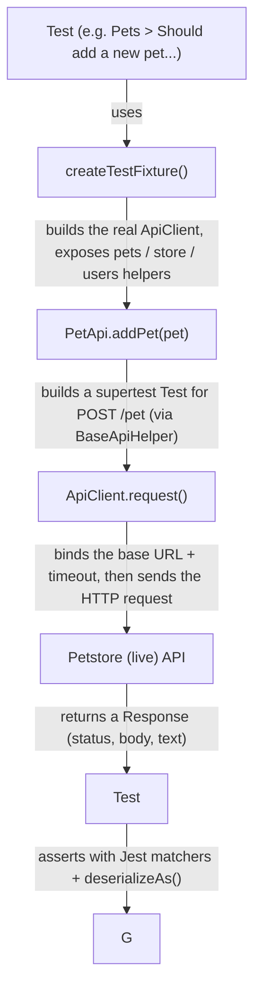

# Petstore TypeScript supertest POC


A TypeScript API automation (testing) framework for the public
[Petstore Swagger API](https://petstore.swagger.io/), built with **supertest** and **Jest**.

This repository is a **proof of concept (POC)**: it shows a small, readable way to build an
HTTP API test suite in TypeScript and is intended as a learning reference.

> This is a TypeScript + supertest proof of concept. The test suite covers the same
> endpoints and uses the Arrange / Act / Assert structure.

---

## Index

1. [Overview](#overview)
2. [Technology stack](#technology-stack)
3. [Prerequisites](#prerequisites)
4. [Getting started](#getting-started)
5. [How the framework works (request flow)](#how-the-framework-works-request-flow)
6. [Project structure](#project-structure)
7. [Configuration](#configuration)
8. [Test walkthrough](#test-walkthrough)
9. [Design principles](#design-principles)
10. [Troubleshooting & common issues](#troubleshooting--common-issues)
11. [Notes & known quirks](#notes--known-quirks)
12. [Reporting](#reporting)
13. [Learning resources](#learning-resources)

---

## Overview

The project automates tests against the **live** Petstore demo API
(`https://petstore.swagger.io/v2`). It does not mock the server — every test makes a real
HTTP request over the internet, which means **an internet connection is required**.

The tests cover the three main areas of the Petstore API:

| Resource | What it models | Example endpoints covered |
| -------- | -------------- | ------------------------- |
| `/pet`   | Pets in a store (`Pet` model) | add, get by id/status/tags, update (JSON + form), upload image, delete |
| `/store` | Shop orders (`Order` model) | inventory, place/get/delete order |
| `/user`  | Registered users (`User` model) | create (single, list, array), login/logout, get by username, update, delete |

> Every operation in the Petstore Swagger spec (`POST/PUT/GET/DELETE` on all `/pet`,
> `/store` and `/user` resources) has at least one test. Coverage is 100% of the
> documented workflows.

### What each library does

- **supertest** — the HTTP client used to send requests and receive responses. It wraps
  [superagent](https://github.com/ladjs/superagent) and gives a friendly, chainable API for
  URL segments, query parameters, JSON/form/multipart bodies, etc.
- **Jest** — the test framework and runner. It provides `describe`/`it`/`expect`, the
  data-driven `it.each`, the watch mode and the CLI used by `npm test`.
- **jest-html-reporters** — produces a rich HTML report of the run.

---

## Technology stack

| Component | Version | Role |
| --------- | ------- | ---- |
| Node.js | 20+ | Runtime |
| TypeScript | 5 | Typed JavaScript, compiled on the fly by ts-jest |
| supertest | 7 | HTTP client for calling the API |
| Jest | 29 | Test framework and runner |
| ts-jest | 29 | TypeScript transformer for Jest |
| jest-html-reporters | 3 | HTML test reporting and logging |

---

## Prerequisites

- **Node.js 20+** (or newer) installed on your machine.
  - Verify with: `node --version`
  - Download it from https://nodejs.org (LTS is fine).
- **Internet access** — the tests hit the live Petstore sandbox.

> Apart from Node.js, **nothing needs to be installed globally**. The dev dependencies
> (supertest, Jest, TypeScript, ...) are installed locally by `npm install`.

---

## Getting started

### Install dependencies

```bash
npm install
```

### Type-check the project

```bash
npm run build
```

This runs `tsc --noEmit` over `src/` and `tests/` and fails on any type error.

### Run the tests

```bash
npm test
```

Test results are printed to the console and an HTML report is written to
`test-report/TestReport.html`. You can filter specific tests with Jest's `-t` flag:

```bash
# only Pet tests
npm test -- Tests/PetTests

# only tests whose name matches some text
npm test -- -t "Should add a new pet"
```

Other useful scripts:

| Script | Description |
| ------ | ----------- |
| `npm test` | Run the whole suite once |
| `npm run test:watch` | Re-run on file changes |
| `npm run test:coverage` | Run with coverage |
| `npm run build` | Type-check only (`tsc --noEmit`) |

---

## How the framework works (request flow)

Reading a test from top to bottom, this is what happens:



Walk through of the pieces, from the inside out:

1. **`createTestFixture`** (`tests/TestFixtureBase.ts`)
   Every suite calls it in `beforeEach`. It constructs a single `ApiClient` (configured from
   `TestSettings`) and instantiates one helper per API resource: `pets`, `store`, `users`.
   Because Jest runs the callback per test, each test gets a fresh HTTP client — keeping
   tests independent of each other.

2. **`TestSettings`** (`src/core/configuration/TestSettings.ts`)
   An immutable settings object built once from environment variables, falling back to
   sensible defaults. It decides the `baseUrl` and `timeoutSeconds` used everywhere.

3. **`ApiClient`** (`src/core/clients/ApiClient.ts`)
   A thin wrapper around supertest. It centralizes the base URL and timeout so the whole
   suite shares the same HTTP configuration (**DRY**).

4. **`IApiClient`** (`src/core/clients/IApiClient.ts`)
   An interface that abstracts building a request. Tests and helpers depend on the interface
   rather than the concrete client, which would allow swapping in a fake implementation for
   unit tests (**SOLID — D**).

5. **`BaseApiHelper`** (`src/core/api/BaseApiHelper.ts`)
   Base class that provides shared plumbing for building requests. Resource-specific classes
   (`PetApi`, `StoreApi`, `UserApi`) only write their own endpoint logic — DRY and
   **Single Responsibility**.

6. **`PetApi` / `StoreApi` / `UserApi`** (`src/core/api/`)
   One class per API resource. Each method maps to one HTTP endpoint, e.g.
   `PetApi.getById(id)` → `GET /pet/{id}`.

7. **Models** (`src/core/models/`)
   TypeScript interfaces (`Pet`, `Order`, `User`, `Category`, `Tag`) that mirror the JSON
   shape of the API. They are the types you serialize to and deserialize from.

8. **`json.ts`** and **`responseExtensions.ts`**
   A single, central JSON configuration (null-stripping, lenient dates) and helpers to
   safely deserialize response bodies (**DRY**).

9. **`responseAssertions.ts`** (`tests/assertions/`)
   Custom Jest matchers that understand a supertest `Response`, offering readable assertions
   like `.toBeSuccessful()` and `.toHaveStatusCode(200)`, plus a `deserializeAs<T>()` helper.

---

## Project structure

```
petstore-typescript-supertest-poc/
│
├── package.json                    # dependencies and npm scripts
├── tsconfig.json                   # TypeScript compiler settings
├── jest.config.js                  # Jest + ts-jest + HTML reporter configuration
├── README.md                       # this file
│
├── src/                            # ---- FRAMEWORK (reusable, no test dependency) ----
│   └── core/
│       ├── api/                     # one helper class per API resource
│       │   ├── BaseApiHelper.ts     #   shared request plumbing
│       │   ├── PetApi.ts            #   every /pet endpoint
│       │   ├── StoreApi.ts          #   every /store endpoint
│       │   └── UserApi.ts           #   every /user endpoint
│       ├── clients/
│       │   ├── IApiClient.ts        # abstraction over the HTTP call
│       │   └── ApiClient.ts         # supertest wrapper (base URL + timeout)
│       ├── configuration/
│       │   └── TestSettings.ts      # env-var driven, immutable settings
│       ├── extensions/
│       │   └── responseExtensions.ts # helpers to read response content
│       ├── models/                  # TypeScript interfaces mirroring the API JSON
│       │   ├── Pet.ts               #   Pet + PetStatus
│       │   ├── Order.ts
│       │   ├── User.ts
│       │   ├── Category.ts
│       │   └── Tag.ts
│       └── json.ts                  # central JSON serialization behavior
│
└── tests/                          # ---- TESTS (test-framework coupled) ----
    ├── setup.ts                    # registers the custom Jest matchers
    ├── TestFixtureBase.ts          # shared test setup (builds client/helpers)
    ├── assertions/
    │   └── responseAssertions.ts   # custom matchers + deserializeAs<T>()
    ├── support/
    │   └── testLog.ts              # console + HTML report logging
    ├── testData/
    │   ├── PetTestData.ts          # factories that build test objects
    │   └── img/dog_photo.jpg       # upload fixture
    ├── PetTests.test.ts            # tests for /pet endpoints
    ├── StoreTests.test.ts          # tests for /store endpoints
    └── UserTests.test.ts           # tests for /user endpoints
```

> The `src/core/` code deliberately does **not** import Jest or the test data. Keeping the
> framework free of test-framework dependencies means it could be reused elsewhere, and
> keeps responsibilities cleanly separated.

---

## Configuration

The framework stays light by reading settings from **environment variables**, with defaults.
Nothing else is required to run the suite.

| Variable | Default | Purpose |
| -------- | ------- | ------- |
| `PETSTORE_BASE_URL` | `https://petstore.swagger.io/v2` | Base URL of the API under test |
| `PETSTORE_TIMEOUT_SECONDS` | `30` | HTTP client timeout, in seconds |

Examples of overriding on the command line:

```bash
# Linux / macOS
PETSTORE_BASE_URL=http://localhost:8080/v2 npm test

# PowerShell (Windows)
$env:PETSTORE_BASE_URL = "http://localhost:8080/v2"; npm test
```

This makes it easy to point the same tests at a local, disposable instance of the Petstore
server (e.g. a Dockerized one) without touching any code.

---

## Test walkthrough

Let's dissect one test to see how the pieces fit together. From `PetTests.test.ts`:

```ts
it('Should add a new pet and retrieve it back', async () => {
  // Arrange
  const pet = createPet({ id: uniqueId(), name: 'Buddy', status: 'available' });

  // Act
  const response = await api.pets.addPet(pet);

  // Assert
  expect(response).toBeSuccessful('the API should accept a well-formed pet');
  expect(response).toHaveStatusCode(200);

  const created = await api.pets.getById(pet.id!);
  expect(created).toBeSuccessful();
  const fetched = deserializeAs<Pet>(created);
  expect(fetched.name).toBe('Buddy');
  expect(fetched.status).toBe('available');

  // Cleanup
  await api.pets.delete(pet.id!);
});
```

Line by line:

1. **`it(...)`** — the Jest function that marks this as a test. The runner discovers and
   executes it.

2. **`async () => {}`** — the test calls an HTTP API, so it is asynchronous and is awaited.

3. **`// Arrange`** — builds the input data. `createPet(...)` (a factory in
   `tests/testData/PetTestData.ts`) returns a fully-formed `Pet` object, keeping the test
   focused on behavior instead of object construction.

4. **`// Act`** — performs the HTTP request. `api.pets.addPet(pet)` sends `POST /pet` with
   the pet serialized as a JSON body and returns a supertest `Response`.

5. **`// Assert`** — verifies the outcome:
   - `expect(response).toBeSuccessful()` — custom matcher; passes only for 2xx codes.
   - `deserializeAs<Pet>(response)` — asserts there is a body and parses it into a typed `Pet`.
   - `expect(fetched.name).toBe('Buddy')` — classic Jest equality check.

6. **`// Cleanup`** — deletes the created pet so the test does not leave garbage on the
   shared sandbox and does not affect other tests.

This **Arrange / Act / Assert (AAA)** structure is used consistently across all tests.

---

## Design principles

The acronyms used in the code comments, explained:

- **SOLID** — five object-oriented design principles.
  - *S — Single Responsibility:* each API helper (`PetApi`, `StoreApi`, ...) only knows its
    own resource. One reason to change.
  - *O / L / I* — the code keeps things open, substitutable and segregated via the
    `IApiClient` interface.
  - *D — Dependency Inversion:* helpers depend on the `IApiClient` abstraction, not on the
    concrete `ApiClient`, so they could be tested with a fake.

- **KISS** — "Keep It Simple". No over-engineered dependency-injection container or
  configuration framework. Environment variables with defaults are enough.

- **DRY** — "Don't Repeat Yourself". Repeating logic (JSON settings, status/deserialization
  checks, request plumbing) lives in one place and is reused.

- **AAA** — every test is explicitly split into `// Arrange`, `// Act` and `// Assert`.

- **DDT** — "Data-Driven Testing". One test body runs many times with different data using
  Jest's `it.each`:

  ```ts
  it.each(['available', 'pending', 'sold'])(
    'Should find pets that are "%s"',
    async (status) => { ... },
  );
  ```

  Each entry produces a separate test run in the report.

---

## Troubleshooting & common issues

| Symptom | Likely cause | Fix |
| ------- | ------------ | --- |
| `node` is not recognized as a command | Node.js is not installed, or not on `PATH` | Install Node.js 20+ and reopen your terminal |
| Tests fail with connection/timeout errors | No internet access, or the Petstore sandbox is slow/down | Check connectivity; retry; raise `PETSTORE_TIMEOUT_SECONDS` |
| Jest reports a TypeScript compile error | A type changed in `src/` or `tests/` | Run `npm run build` to see the full error |
| A test that should pass is flaky | The shared live sandbox was modified by other users or a prior failed run left data behind | The Ids are random to avoid collisions; run the suite again |
| Upload test fails to find the image | The `testData/img` folder is missing or was not copied | Ensure `tests/testData/img/dog_photo.jpg` exists |

---

## Notes & known quirks

- The Petstore demo serializes dates like `2023-12-06T10:43:14.823+0000`. JavaScript's
  `Date` parser is lenient about this; `src/core/json.ts` exposes a `parseLenientDate`
  helper for lenient date parsing.
- Tests run against a **shared, live, third-party sandbox**. The server can return
  `503`/timeouts or behave inconsistently under load; data created by other users can cause
  an occasional non-deterministic result.
- This is a POC, so it intentionally favors simplicity over production-scale engineering
  (e.g. one file per resource, no logging layer, no CI pipeline).

---

## Reporting

This project uses **jest-html-reporters** to generate an HTML test report. After running the
tests, the report is created in the `test-report/` directory.

### How to view the report

1. Run the tests:
   ```bash
   npm test
   ```
2. Open `test-report/TestReport.html` in your web browser.

The report provides a detailed overview of the test execution, including:
- Pass/Fail/Skip status for each test.
- Execution time.
- Log entries added during the test steps (e.g. request parameters, response codes).
- Console output.

### Implementation details

- **Configuration**: the reporter is registered in `jest.config.js` under `reporters`, with
  `publicPath: './test-report'`.
- **Logging**: `tests/support/testLog.ts` writes to the console and attaches messages to the
  report via `addMsg(...)` from `jest-html-reporters/helper`. Test methods use
  `log.info(...)` / `log.pass(...)` to record specific steps and observations.

---

## Learning resources

- **supertest**: https://github.com/ladjs/supertest — the HTTP client used here.
- **Jest**: https://jestjs.io/docs/getting-started — assertions, matchers and the runner.
- **jest-html-reporters**: https://github.com/Hazyzh/jest-html-reporters — HTML reporting.
- **TypeScript**: https://www.typescriptlang.org/docs — the type system used here.
- **Petstore Swagger spec**: https://petstore.swagger.io — the API under test (you can browse
  the endpoints in your browser).
